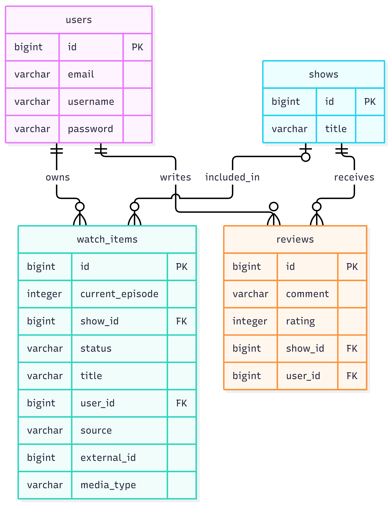
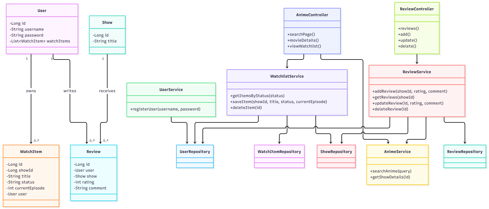

# 🌸 Sakura Anime Hub

Sakura Anime Hub is a Java web application for searching anime and TV shows, managing a personal watchlist, and publishing reviews and ratings.

The project was developed as part of the **Object-Oriented Programming and Databases** course.

## Technologies

- Java
- Spring Boot
- Spring Data JPA / Hibernate
- PostgreSQL
- Spring Security
- Thymeleaf
- HTML, CSS, JavaScript
- Maven
- TVmaze API

## Features

### User Authentication
- User registration and login
- Password hashing using Spring Security
- Personal data associated with registered users

### Anime and TV Show Search
- Search through the TVmaze API
- Detailed information about selected shows
- Automatic saving of show information when needed

### Personal Watchlist
- Separate watchlist for each registered user
- Four statuses: Watching, Planned, Completed, Dropped
- Episode progress tracking
- Adding, viewing, updating and deleting watchlist entries

### Reviews and Ratings
- Publishing reviews for anime and TV shows
- Rating shows from 1 to 10
- Viewing published reviews
- Editing and deleting personal reviews
- Ownership checks to prevent users from modifying other users' reviews

## Database

The application uses PostgreSQL with Spring Data JPA and Hibernate.

The active database schema contains four related tables:

| Table | Description |
|-------|-------------|
| `users` | Registered users and authentication data |
| `shows` | Anime and TV show information |
| `watch_items` | Personal watchlist entries |
| `reviews` | User reviews and ratings |

### Database Relationships

- `users.id` → `watch_items.user_id`
- `users.id` → `reviews.user_id`
- `shows.id` → `watch_items.show_id`
- `shows.id` → `reviews.show_id`

These relationships are implemented using foreign keys in PostgreSQL.

The database is designed to organize user information, show information, watchlist entries and reviews into separate related entities.

Legacy tables were moved to the `archive` schema and are not part of the active application.

### ER Diagram

### UML Class Diagram

## CRUD Operations

The application demonstrates CRUD operations on two main entities.

### Watch Items

- **Create:** Add a show to a personal watchlist
- **Read:** View saved shows and their statuses
- **Update:** Change watchlist status or episode progress
- **Delete:** Remove a show from the watchlist

### Reviews

- **Create:** Publish a review and rating
- **Read:** View reviews for a selected show
- **Update:** Edit a personal review
- **Delete:** Delete a personal review

These operations are implemented using Java services, Spring Data JPA repositories and web controllers.

## SQL Queries and Reports

The project includes SQL examples demonstrating:

- `JOIN` and `LEFT JOIN`
- `COUNT`, `AVG`, `MIN` and `MAX`
- `GROUP BY`
- `FILTER`
- `ORDER BY`
- CRUD operations using `INSERT`, `SELECT`, `UPDATE` and `DELETE`
- Transactions using `BEGIN` and `ROLLBACK`

SQL reports include:

1. Users and their saved anime
2. Number of watchlist entries per user
3. Reviews with usernames and show titles
4. Average ratings and review counts for shows

See `docs/sakura.queries.sql`.

## Running the Project

1. Install Java, Maven and PostgreSQL.
2. Create a PostgreSQL database.
3. Configure the database connection in `src/main/resources/application.properties`.
4. Make sure PostgreSQL is running.
5. Run `DemoApplication.java` from IntelliJ IDEA or start the application using Maven.
6. Open http://localhost:8080 in a browser.
7. Register an account or log in to use the personal watchlist and reviews.

The application requires an internet connection to retrieve show information from the TVmaze API.

## Project Structure

- `src/main/java/com/example/demo/` — Java source code
- `src/main/resources/templates/` — Thymeleaf HTML templates
- `src/main/resources/static/` — Static resources
- `src/main/resources/application.properties` — Application configuration
- `docs/ER-Diagram.png` — Database ER diagram
- `docs/UML-Diagram.png` — UML class diagram
- `docs/sakura.queries.sql` — SQL queries and CRUD examples
- `pom.xml` — Maven configuration

## Project Purpose

The purpose of Sakura Anime Hub is to demonstrate:

- Object-oriented programming in Java
- Relational database design
- Database relationships and foreign keys
- Spring Boot and PostgreSQL integration
- User authentication and authorization
- CRUD operations on multiple entities
- SQL queries, joins and aggregate reports
- Web application development using MVC architecture
